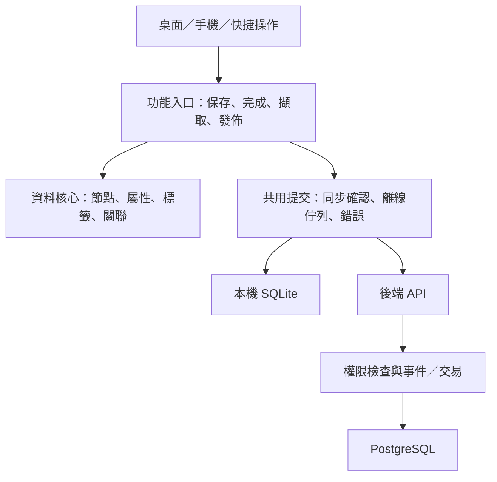

# Onden 功能解構地圖

> 狀態：現行（最後確認 2026-11-18）
> 涵蓋：packages/backend/src/modules/index.ts, packages/frontend/src/modules/index.ts, packages/frontend/src/lib/tagModules.ts, packages/backend/src/routes/mcpProtocol.ts

這份地圖把專案拆成可以分別理解、驗證和重構的能力。它是手寫的（沒有腳本產生它），表格列出的是現在的入口；
不要求現在搬動所有檔案。已被取代的 RSS 拆分範例、早期的「現有基礎與下一步」在 [feature-map-history.md](feature-map-history.md)。

逐項驗收與剩餘範圍見 [全功能盤點清單](../research/full-feature-audit.md)：依使用案例追蹤
入口、桌面／手機、正常與失敗情境、既有證據及缺口。本文件用來理解責任，清單用來追蹤驗證進度。

## 先掌握三種責任

1. **功能**：使用者要完成的事，例如保存筆記、完成任務、留下文章重點。
2. **資料核心**：功能共用的節點、屬性、標籤、關聯與媒體引用。
3. **共用服務**：儲存、同步、錯誤回報、權限、事件與背景工作。

桌面、手機、指令面板是功能的不同入口。表格、看板、關係圖可以呈現同一份資料，
不必各自發明一套保存規則。資料共用也不代表領域規則要集中成一個巨大的服務。

這是理解用的簡化資料流。尚未遷移的功能仍有直接 API 呼叫；
上圖不表示所有讀寫都已經通過同一個前端模組。權限的最終執行點在後端。

## 功能清單與責任邊界

路徑未註明套件者，前端在 `packages/frontend/src/`，後端在 `packages/backend/src/`。

| 功能 | 使用者操作 | 應由它負責的規則 | 主要依賴 | 現有程式入口 |
| --- | --- | --- | --- | --- |
| 筆記與捕捉 | 新增、編輯、改名、刪除、還原 | 草稿生命週期、保存確認、筆記歷史 | 節點、媒體、共用提交 | `modules/capture/QuickCapture.tsx`、`components/OverviewEditorHost.tsx`、`lib/data/draftActions.ts`、`lib/data/noteWriter.ts`、`lib/data/noteHistoryWriter.ts` |
| 標籤、屬性與集合 | 套標籤、填欄位、建 schema、切表格／看板 | 欄位定義與值、成員關係、查詢／檢視設定 | 節點、屬性、標籤 | `components/NodeAttributesPanel.tsx`、`components/tagPage/`、`components/collections/`、`lib/data/propertyWriter.ts`、`lib/data/tagWriter.ts`、`lib/data/tagSchemaWriter.ts` |
| 任務 | 新增、完成、延期、設定重複 | 任務狀態、日期清單、重複任務規則 | 筆記、任務屬性、背景排程 | `modules/tasks/TasksMode.tsx`、`lib/data/taskWriter.ts`、`lib/data/taskAgenda.ts`、後端 `modules/tasks/`（[任務模組](tasks-module.md)、[日子時間線](day-timeline.md)） |
| RSS 閱讀 | 訂閱、略過、保存文章、把重點放進筆記 | 文章暫存、已看狀態、保存成筆記、來源關聯 | 筆記、關聯、背景抓取 | 前後端 `modules/rss/`（保存：後端 `modules/rss/save.ts`；摘錄：前端 `modules/rss/rssQuote.ts`） |
| 功能的開關與既有的標籤功能引用 | 在設定開關內建功能；標籤頁只顯示、移除舊的功能引用（2026-11-12 起標籤頁沒有「＋ 加功能」，使用者的標籤只帶欄位與檢視） | 哪些功能開著、功能引用的保存；不授予額外讀寫權 | 工作區設定、功能引用表 | `lib/tagModules.ts`、後端 `services/functionRefs.ts`、`services/tagCatalog.ts`、`components/tagPage/`、`lib/data/tagConfigWriter.ts`（[模組庫](module-library.md)） |
| 複習 | 套用具複習功能的標籤、取得到期卡片、評分 | 複習排程、記憶狀態、每日數量 | 筆記、複習屬性 | 前後端 `modules/review/` |
| 白板與關係圖 | 加卡片、拖移、連線、整理布局 | 白板保存座標；關係操作保存語意連結 | 筆記 ID、關聯、布局資料 | `hooks/useCanvasActions.ts`、`modules/graph/LocalGraphLens.tsx`、`lib/data/canvasWriter.ts`、`lib/data/relationWriter.ts` |
| 搜尋與查詢 | 搜尋筆記、篩選、查反向連結 | 可讀資料範圍、查詢條件、排序與結果 | 資料核心、搜尋索引、權限 | `hooks/useOverviewSearch.ts`、`lib/data/noteSearch.ts`（`reads.notes.search`）、後端 `routes/query.ts` |
| 網站 | 編輯版型、選首頁、預覽、發佈 | 網站草稿、設定、發佈前置條件與結果 | 筆記、工作區設定、發佈服務 | `modules/website/WebsiteScreen.tsx`、`modules/website/studio/`、`modules/website/websiteWriter.ts`、`lib/data/workspaceWriter.ts` |
| AI 與變更審核 | 讓自己的 AI 透過 MCP 操作、審核變更（伺服器只在使用者自己的 API 金鑰下提建議，見 [decisions-ai-collaboration.md](../agents/decisions-ai-collaboration.md)） | 工具授權、技能 prompts、建議與審核流程 | 搜尋、領域操作、權限、事件 | `components/InboxReview.tsx`、後端 `routes/mcpProtocol.ts`、`routes/skills.ts`、`routes/inbox.ts`、`services/agentTools/`、`services/harness/` |
| 資料移轉與管理 | 匯入、匯出、備份、設定儲存位置 | 格式轉換、來源識別、覆蓋保護、還原與資料完整性 | 資料核心、儲存、工作區權限 | 後端 `modules/importers/routes.ts`、`modules/importers/markdown/note.ts`、`modules/importers/shared/identity.ts`、`routes/export.ts`；前端 `lib/localDbSchema.ts`、`lib/fileSystemStorage.ts` |

表中的一列是一組可理解的責任，未必只對應一個檔案或單一模組。例如集合的 schema
與檢視配置可以有自己的子模組；白板布局和語意關聯也各有自己的寫入模組。
不把整列硬塞成另一個大檔案。

## 三個容易混淆的邊界

### 資料表示與功能規則

任務在儲存層沿用節點／屬性，呼叫端仍應使用 `taskWriter.patch` 表達延期或完成。
呼叫端不需要知道哪些保留屬性代表任務狀態，也不負責建立下一次重複任務。

同樣地，複習模組管理記憶狀態，筆記模組管理內容；修改文章文字不需要理解複習演算法。

### 頁面與功能

表格裡勾選任務、任務頁裡勾選任務，可以使用同一套任務操作。
手機與桌面可以有不同布局，保存、錯誤與離線契約應一致。
這是後續遷移的目標，不表示所有現有入口都已對齊。

### 語意連結與座標

「A 是 B 的參考資料」是關聯；「A 的卡片在白板左上角」是布局。
移動卡片不應改變參考關係。這兩種操作可以在同一個畫面發生，仍由不同責任管理。

## 每個功能用一張說明卡管理

| 欄位 | 要寫清楚的內容 |
| --- | --- |
| 目的 | 使用者要完成的一件事 |
| 入口 | 哪些畫面、快捷鍵或 agent 工具會觸發 |
| 輸入與輸出 | 最少需要哪些資料，回傳什麼結果 |
| 規則與資料責任 | 哪些狀態只能由這個功能決定或修改 |
| 依賴 | 呼叫哪些公開操作，不讀寫哪些內部實作 |
| 完成與失敗 | 何時能清除輸入；部分成功、離線、重試如何表達 |
| 驗證 | 一條正常流程、一條失敗流程，及此功能特有的不變條件 |

重構的單位可以是一張說明卡。卡片上的規則、操作與測試能對得上，就有明確的停止點。
只有搬動程式碼、呼叫端仍要理解相同細節時，還沒有建立足夠清楚的邊界。

## 模組與依賴方向

- **內建模組可由擁有者開關**：模組目錄加註冊表（前後端各一份 `modules/index.ts`），關掉後資料保留、介面不留痕跡
  （`packages/frontend/src/test/moduleOffNoTrace.test.ts` 逐一檢查每個可切換模組；機制見 [模組庫](module-library.md)、[模組表](core-vs-modules.md)）。
- **建議依賴方向**：選用功能依賴資料核心和共用服務；資料核心對選用功能的具體實作保持獨立。
- **仍待整理**：大型畫面中的多步協調、部分直接 API 呼叫、跨模組讀取與資料責任。
- **學生的閱讀順序**：先沿「編輯筆記 → 保存 → 失敗保留草稿」追一條完整流程，再理解共用提交，最後選 RSS 或複習深入。每次只增加一塊要掌握的責任。

## 對照程式與既有文件

- 資料型別：`packages/frontend/src/lib/api.ts`
- 領域入口：`packages/frontend/src/lib/data/`
- 前端模組規則：`packages/frontend/src/modules/README.md`
- 後端模組規則：`packages/backend/src/modules/README.md`
- 已註冊模組：`packages/backend/src/modules/index.ts`
- 已完成的寫入重構：[domain-writes.md](domain-writes.md)、[website-writes.md](website-writes.md)
