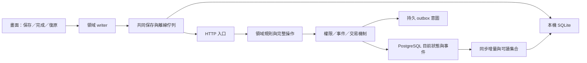

# 核心設計審查 — 2026-09-13

> 狀態：已被取代（by core-design-fixes-2026-09-13.md）（最後確認 2026-11-01）

結論：**核心模型值得保留，但目前不能把共用機制的存在視為一致性與授權已獲保證。**
以伺服器資料庫為權威、以節點／屬性／標籤共用資料、用事件支援歷史與同步、用領域 writer
封裝保存，適合目前以學生個人使用為主的 Onden。主要問題是部分領域規則仍在交易外，
以及普通節點 API 能改變帶有政策意義的身分。這些有可定位的改善邊界，沒有構成整套重寫的理由。

基線：`719ce80` 加目前工作樹。保留既有未提交修改，沒有子代理。本輪新增審查文件與診斷腳本，
**沒有修改正式程式或修復下列缺陷**。優先級 P1／P2 表示已重現缺陷的處理優先，不同於功能清單的盤點優先。

> 後續狀態：同日修復已完成，見 [核心修復與驗證](core-design-fixes-2026-09-13.md)。
> 以下保留修復前的觀察與行號，不代表目前工作樹仍有這五組缺陷。

## 實際重現的問題

### C5／GAP-12 — P1：普通 node_type 修改能關閉其他筆記的政策

- 程式：[nodes PATCH](../../packages/backend/src/routes/nodes.ts#L351) 只宣告 `write_node`，
  [同一 apply](../../packages/backend/src/routes/nodes.ts#L386) 接受 `node_type`。
  政策查詢（`services/dispatcher/permissions.ts`，已移除） 只納入 live `class_tag`。
- 重現：建立要求 admin 才能讀寫的政策標籤並套在筆記上。editor 讀該筆記是 403；
  對標籤節點送普通 PATCH，將 `class_tag` 改為 `content`，得到 200；再讀原筆記變成 200，寫入政策也已放行。
  `membership_epoch` 前後都是 9。沒有改 policy JSON，也沒有通過 `principal_admin`。
- 前提：該 editor 可以編輯標籤節點本身；一般未另受標籤政策限制的標籤符合此情形。
  不是宣稱每個受限操作者都能編輯每一個標籤，也沒有證據表示正式環境已遭利用。
- 設計意義：**共用儲存不等於共用變更權限。** `node_type` 會決定一個節點是否提供授權政策，
  不能當作與普通正文相同的欄位。這把先前 DEC-03 的疑點提升為已重現問題。
- 改善草圖：A，在普通 PATCH 中加入型別轉換政策；B，普通 PATCH 不接受政策身分轉換，交明確領域操作。
  偏向 B：讓一般內容修改不必理解政策轉換；轉換操作自身擁有權限、關聯相容性、事件與 epoch。
  正反向及 agent 入口需要一併遷移，本輪未改授權語意。

### C1／GAP-13 — P1：等待寫入鎖的操作沿用撤權前的判定

- 程式：[mutate.ts:169](../../packages/backend/src/spine/mutate.ts#L169) 先 `assertAuthority`，
  到 [210](../../packages/backend/src/spine/mutate.ts#L210) 才取得事件交易鎖。
- 重現：政策交易先持有工作區鎖；editor 的 PATCH 通過舊 `write_node:editor` 判斷，
  在 PostgreSQL 中確實進入 advisory lock 等待。政策交易改成 `write_node:admin` 並提交，
  PATCH 隨後取得鎖，仍回 200 並保存 sort_order=73。
  此時直接權限檢查拒絕；重新送出的同類請求回 403，證明問題在交錯時序。
- 界線：這是撤權前已開始、撤權後才提交的在途請求；沒有宣稱撤權後新請求也能繞過。
  目前共用入口不能保證按寫入鎖內的政策決定是否提交，事件／狀態的提交順序與授權觀察時點分離。
- 改善草圖：A，要求每個領域自行先開交易、鎖定再查權限；B，共用寫入操作在鎖內執行必要授權。
  偏向 B 收回共同時序，領域仍擁有需要哪些能力。ActorCtx 的角色／token 新鮮度要另外定義，
  不能以挪動這一次查詢就宣稱所有撤權競態已解決。

### C2／C2b／GAP-14 — P1：筆記 PATCH 在鎖外計算合併與結構守衛

- 程式：[鎖外讀取與三方合併](../../packages/backend/src/routes/nodes.ts#L259)、
  [父層循環檢查](../../packages/backend/src/routes/nodes.ts#L324)、
  [稍後寫入](../../packages/backend/src/routes/nodes.ts#L373)。
- 文字重現：A 改第一段、B 改最後一段，兩個請求都帶同一份 `base_markdown`，
  並在事件鎖前讀完舊狀態。兩次 PATCH 都回 200，最後只剩 B 的修改，沒有 `BODY_CONFLICT` 紀錄。
  同樣資料改成先等待 A 成功再送 B，兩邊修改都保留，證明問題是讀取基準的時間點。
- 結構重現：A、B 原本都是根節點，同時要求 A.parent=B、B.parent=A；兩者在鎖前都通過循環檢查，
  依序寫入後回 200／200，DB 中實際形成兩節點循環。
- 同一處鎖外舊值也用來建立 inverse patch／prev_field_values；本輪沒有另外執行並行改名後復原，
  因此不把其結果算成已重現。文字會留在既有版本紀錄的範圍也不等於目前正文沒有遺失修改。
- 設計意義：**把 UPDATE 放進交易不夠；決定可以寫什麼的讀取和判斷也要在同一一致性邊界。**
- 改善草圖：A，把完整 edit/move 使用案例的讀取、合併、守衛、事件組裝移到既有事件交易內；
  B，讀取版本後以 CAS 驗證，衝突時重新計算。以目前已有工作區鎖和個人負載，偏向先做 A。
  不需要先新增分散式鎖、CRDT 或新的事件框架。此取捨未經效能量測，不宣稱吞吐量改善。

### C3／GAP-15 — P1：空同步頁的游標可能跨過未交付事件

- 程式：[sync.ts:34](../../packages/backend/src/routes/sync.ts#L34) 讀事件頁，
  [44](../../packages/backend/src/routes/sync.ts#L44) 另外讀 MAX(id)，
  [82](../../packages/backend/src/routes/sync.ts#L82) 在空頁時採用後者。
- 重現：從游標 22 查到真正的空頁，暫停在該 SQL 回傳後；另一操作更新既有筆記並提交事件 23；
  恢復後 MAX 讀到 23，回應沒有該筆記卻給游標 23。接著從 23 同步，仍沒有該更新。
  沒有偽造 SQL 結果；只在兩次真實查詢之間加入可重現的排程點。
- 影響：正常增量鏈會跳過此變更，直到後續該筆記再有事件或其他完整刷新才可能補回。
  [前端](../../packages/frontend/src/lib/useAppData.ts#L354) 會保存空頁推進的游標，因此不是只有測試客戶端受影響。
  同步傳目前資料列而不是重播所有事件，本身合理；游標只能確認已涵蓋的事件範圍。
- 改善草圖：A，空頁保留輸入游標；B，事件頁與高水位取自同一可靠快照。
  普通增量情境偏向 A，對錯誤／未來游標及歷史清理另保留明確的重新同步契約。
  不能將此局部修正誤稱為同步內容與可讀集合快照已全面一致。

### C4／GAP-16 — P2：outbox 舊失敗會終止較新的工作

- 程式：[成功分支](../../packages/backend/src/services/outbox.ts#L470) 用 xmin 核對同一版本；
  [失敗分支](../../packages/backend/src/services/outbox.ts#L475) 更新 attempts／dead 時只按 id。
- 重現：v1 已失敗兩次、上限三次；執行第三次期間重新保存 v2，enqueue 將同一 pending row
  換為 v2 並把 attempts 清零。v1 的執行函式丟錯後，舊執行器仍把目前 v2 那列改成 dead／attempts=3。
  真正執行過的 payload 只有 v1，v2 尚未執行就停止自動重試。
- 這是 outbox 資料庫狀態機與注入 performer 的重現，沒有呼叫真實 GitHub／Git 備份。
- 改善草圖：A，所有結算分支共用同一版本核對；B，分離 immutable 執行嘗試與最新待辦。
  偏向 A 沿用現有機制，失敗的重試／終止也只結算自己讀到的版本，先不新增整個工作平台。

## 仍合理、值得保留的核心

| 選擇 | 程式證據與實際價值 | 使用界線 |
| --- | --- | --- |
| PostgreSQL 保存目前狀態，事件支援歷史／增量 | `db.ts` 的交易、`sync.ts` 從事件選目標再讀資料列 | 不是完整 event sourcing；不能假定只靠事件就能重建所有資料 |
| 節點／標籤／屬性共用資料身分 | `schema.sql`、`tasksStore.ts`、`modules/review/routes.ts` | 能重用關聯與歷史，但領域規則仍需專屬操作；C5 就是界線沒有守住 |
| 寫入與事件共用交易、操作者由 ActorCtx 推導 | `spine/mutate.ts`、`db.ts`、`spine/idempotency.ts` | 已消除許多重複機制，仍須處理 C1／C2 與既有外層 rollback 限制 |
| 外部副作用走 transactional outbox | 備份 intent 同交易 enqueue，之後獨立執行、可重試 | 至少一次執行；不同外部操作的冪等能力不同，還有 C4 |
| 內容游標與可讀集合版本分開 | `sync.ts`、`membershipReconcile.ts` | 概念必要；不能以局部測試通過推定跨裝置撤權全完成 |
| 前端用領域 writer 與共同保存結果 | `noteWriter.ts`、`writeLifecycle.ts`、`writeQueue.ts` | 呼叫者能分辨 synced／queued，提交後快取失敗不改判未提交；全入口尚未遷移完成 |
| 靜態模組註冊 | `modules/index.ts` 的明確清單與 registry | 適合目前 RSS／複習，不必為兩個模組建立動態插件平台；不代表一切皆可獨立停用 |

已遷移入口的簡化依賴如下。領域操作是要繼續補齊的邊界，不是宣稱每個路由都已做到。

## 理解負擔主要在哪裡

1. **mutate 是共用機制，還不是完整的筆記領域操作。** 普通 PATCH 的呼叫者仍須理解基準讀取、
   body merge、父層政策與循環、逆向資料、事件、索引、backup／embed 與 post-commit cascade。
   最近的 importMarkdownNote、restoreEvent 已有較完整的操作邊界，應把同樣方式用在普通保存。
2. **共同資料表示仍向讀取與同步層洩漏相容細節。** 後端 task 已是 node，傳輸和前端仍維持
   nodes／tasks 兩種集合，sync 和 bootstrap 因此需要 `taskNodeIdsAmong`、`notATaskNodeSql` 等分流。
   維持舊 API 是合理相容成本；應明確集中在 adapter，不能只靠「資料表統一了」判定設計已簡單。
3. **政策定義、普通標籤與功能開關共用物件。** `class_tag` 的 type、schema、套用關聯與父層均可能
   改變其他節點的可讀集合；`task`／`review` 等能力又按名稱辨識。能力標籤改名停用是既有產品取捨，
   不在本輪偷偷更換；但政策身分變更必須提升成明確操作。
4. **部分註解與設計文件的保證強於實作。** mutate 的「by construction」沒有涵蓋讀取基準與等待鎖時的政策；
   `sync-protocol.md` 明列 draft／target，包含尚未遷移的事件 DAG 及佇列退場方案。
   可保留研究草圖，但閱讀順序應以目前程式契約與實測為先。

這些判斷針對修改者必須同時理解的概念，沒有以檔案行數或測試數當作設計品質分數。
沒有代表性效能量測，因此本輪不宣稱全表政策查詢太慢、工作區鎖足夠快，或任何方案能提升吞吐量。

## 驗證與可重現性

- 診斷：[core-design-repro-2026-09-13.mts](core-design-repro-2026-09-13.mts)。
  僅允許本機 `onden_core_review_test` 與 NODE_ENV=test；使用正式 Hono router、交易與 SQL。
  等待中的 writer 由 PostgreSQL `pg_stat_activity` 確認，沒有用固定長 sleep 假定時序。
  6 個診斷結果對應 5 組缺陷（C2 與 C2b 為同一基準／守衛問題）。
  腳本斷言的是**缺陷確實出現**，退出 0 不是正式功能測試通過；未納入一般 regression suite。
- 專用容器 `onden-browser-test-pg-20260908`、連線埠 15432，從目前 schema 建立診斷庫。
  日常資料庫未動。合成資料保留在診斷庫便於追查；沒有啟動新應用伺服器。
- 既有後端核心回歸：8 檔／67 項通過，0 跳過，4.35 秒；使用另一個隔離庫 `onden_source_final_test`。
  涵蓋 spine、冪等 claim、事件交易、復原原子性／授權、讀取政策對照與 outbox。
- 既有前端核心回歸：4 檔／44 項通過，1.39 秒；涵蓋 note writer、write queue、membership reconciliation、版本復原。
- 兩者證明已有行為基礎，同時說明既有 suite 沒有覆蓋這些新診斷時序；不能用前批
  1,657／1,258 項全綠否定本輪的失敗證據。本輪沒有重跑完整 suite、瀏覽器或真機。
- 原始執行紀錄：`/tmp/onden-core-design-repro-2026-09-13.log`、
  `/tmp/onden-core-review-backend.log`、`/tmp/onden-core-review-frontend.log`。
  六組結果另保存為 [JSONL](core-design-repro-2026-09-13.jsonl)。

## 後續範圍

先封住 C5 的政策身分旁路，再選一批完整的「普通筆記保存／移動」案例修正 C1／C2，
接著修 C3 的游標與 C4 的工作版本結算。把這些診斷轉成要求正確行為的回歸案例後才算修復。
可讀集合快照、跨重載冪等、外層交易回滾、完整 cascade／多實例部署等仍是另外的驗收範圍。
沒有必要在此前擴充微服務、事件 DAG、CRDT 或分散式共識；先把目前架構宣告的保證做實。
